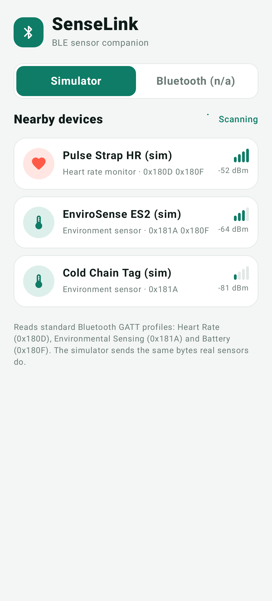
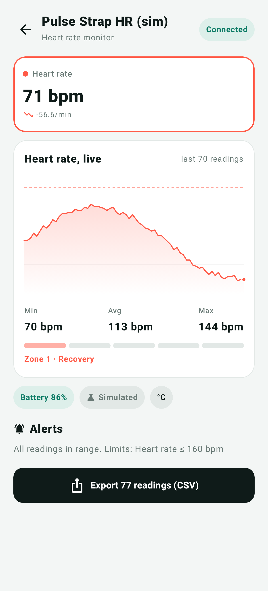
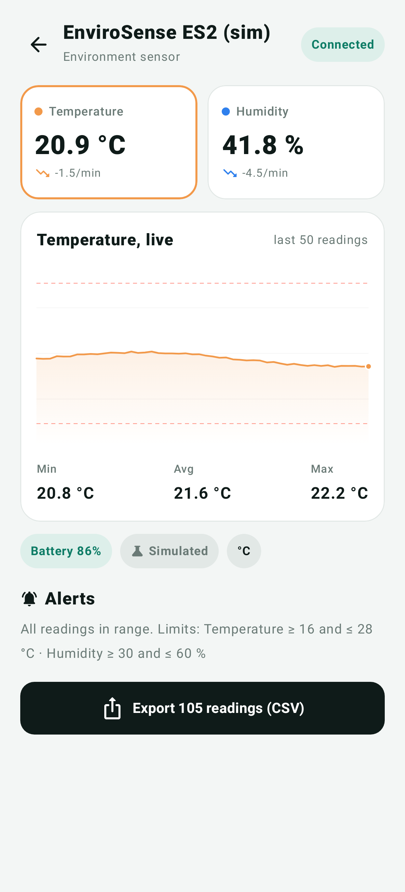
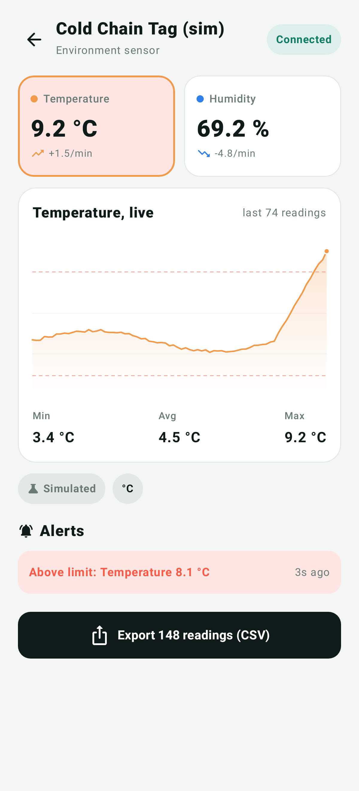

# SenseLink: BLE sensor companion (Kotlin Multiplatform, Android + iOS)

A **Kotlin Multiplatform** app with one **Compose Multiplatform** UI for **Android and iPhone** that connects to **Bluetooth Low Energy** sensors: heart rate straps and temperature/humidity sensors. It scans, connects over GATT, subscribes to notifications, parses the standard Bluetooth SIG formats byte by byte, charts live data, raises threshold alerts and exports CSV. A built-in **simulator** sends the same bytes real sensors do, so everything works without hardware.

<p>
  
  
  
  
</p>

## Try it

| Platform | How |
| --- | --- |
| **Android 8+** | Download `SenseLink.apk` from the [latest release](https://github.com/neomaverick1/senselink/releases/latest). Start with the **Simulator**, then switch to **Bluetooth** to pair a real heart rate strap (any standard 0x180D strap) or an environmental sensor (0x181A). |
| **iPhone simulator** | Download `SenseLink-iOS-Simulator.zip` from the same release, unzip and drag `SenseLink.app` onto a booted simulator (the simulator has no Bluetooth, so use the built-in simulated sensors). |

Every push builds the Android APK, runs the shared tests on the JVM **and on the iOS simulator (Kotlin/Native)**, renders the screenshots with Robolectric + Roborazzi, generates the Xcode project, builds the iPhone app and publishes a release ([`.github/workflows/build.yml`](.github/workflows/build.yml)).

## Features

| Area | What it does |
| --- | --- |
| **Scan** | Finds devices advertising Heart Rate (0x180D) or Environmental Sensing (0x181A), sorted by signal strength, with RSSI bars and the advertised services. |
| **Connect & subscribe** | GATT connect, service discovery, notifications enabled through the CCCD descriptor (0x2902), battery read (0x2A19). Android serialises GATT operations through a queue (Android allows one at a time) and auto-reconnects; iOS keeps a pending reconnect with CoreBluetooth. |
| **Spec-correct parsing** | Heart Rate Measurement (0x2A37): 8/16-bit values, sensor contact, energy expended, RR intervals in 1/1024 s. Temperature (0x2A6E, signed 0.01 °C), Humidity (0x2A6F, 0.01 %), "unknown" sentinels, truncated packets rejected. |
| **Live dashboard** | Current value, trend per minute (linear regression), min/avg/max over the window, heart-rate zones, a live chart with alert limits drawn on it, °C/°F. |
| **Alerts** | Limits that fit the sensor (heart rate > 160 bpm, cold chain 2–8 °C, room temperature and humidity ranges) with **hysteresis**, so a value hovering at the limit doesn't flap. |
| **CSV export** | Every reading with timestamp, unit and notes (RFC 4180 quoting) through the system share sheet. |
| **Simulator** | A heart rate strap doing an interval workout, a room sensor, and a cold-chain tag with a door-open excursion that trips the alert. |

## Architecture

```
composeApp/src/
  commonMain/   shared by Android and iOS
    ble/          BleClient interface, GATT UUIDs + parsers/encoders, simulator
    logic/        alert engine (hysteresis), rolling series + trend, HR zones, CSV, rules per sensor type
    ui/           Compose Multiplatform screens: scan, live device dashboard, chart (Canvas)
    AppState.kt   scanning, connection lifecycle, readings, alerts (coroutines + Flow)
  androidMain/  BluetoothLeScanner + BluetoothGatt client, runtime permissions, FileProvider CSV share
  iosMain/      CoreBluetooth client (CBCentralManager / CBPeripheral delegates via Kotlin/Native), share sheet
  commonTest/   parser, alert, series, CSV and simulator tests (run on JVM and iOS)
  androidUnitTest/  Robolectric + Roborazzi screenshot tests
iosApp/         SwiftUI host app (XcodeGen project.yml), embeds the shared framework
```

## Build it yourself

```bash
./gradlew :composeApp:testDebugUnitTest          # shared + screenshot tests
./gradlew :composeApp:recordRoborazziDebug       # re-render docs/screenshots
./gradlew :composeApp:assembleRelease            # Android APK
./gradlew :composeApp:iosSimulatorArm64Test      # shared tests on iOS (macOS)
cd iosApp && xcodegen && open SenseLink.xcodeproj
```

## Stack

Kotlin 2.0 Multiplatform · Compose Multiplatform 1.7 (Material 3) · Coroutines & Flow · Android BLE (BluetoothLeScanner, BluetoothGatt) · CoreBluetooth via Kotlin/Native · Robolectric + Roborazzi · XcodeGen · GitHub Actions

MIT licensed.
